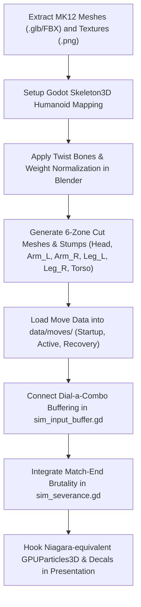

# Complete MK12 Asset Breakdown & Godot Implementation Master Guide

This document presents a comprehensive, zero-assumption breakdown of all extracted data from `D:\05cfbdd1648afe2928109b70ab63880a4bc8f7b4 (1)\Output\Exports\MK12` (Johnny Cage character suite: 15,984 JSON assets, 427 C++ reflection headers, skeleton, animation sequences, cuts, physics assets, Niagara VFX, materials, and game libraries) and concrete implementation specifications for the Godot 4.3 deterministic combat project (**Greek-Curse / Zeus Balls**).

---

## 1. Complete MK12 Asset Architecture Analysis

The exported folder contains the complete Unreal Engine 4 / NetherRealm Studios (NRS) engine export for **Johnny Cage** (`Content/Disk/Char/JohnnyCage` and shared game libraries):

```
MK12/
├── Config/ (Engine, DeviceProfiles, Scalability, Quality, Input)
├── Plugins/ (Engine and NRS custom plugin reflection headers)
└── Content/Disk/
    ├── Char/JohnnyCage/
    │   ├── Anim/ (Attack, Brutality, EndOfRound, Fatality, Intro, Kustomize, Nav, Quitality, Special, Supermove, TestYourMight, Victory)
    │   ├── Dism/ (CutLibrary, Body001, Body002, Body009, Head001, Head009, Meaty, Skully)
    │   ├── Face/ & Facial/ (Facial bone rigs, morph anims, JCVD face rig)
    │   ├── FX/ (CineFX, Gameplay Niagara Systems: NS_ShadowKick, NS_NutPunch_Trail, NS_HypeKick, NS_Speed_Dust, NS_PhoneFlash)
    │   ├── Game/ (Inventory, CharacterContentDefinition, Libraries, Dialogue, Props)
    │   ├── Gear/ & Hair/ (Sunglasses, belt, head accessories, grooms)
    │   ├── Skin/ (001 - 009: Skeletal meshes, Cloth simulation JSON, LODs, material instances)
    │   └── Template/Mesh/ (SK_JohnnyCage_Template_Skeleton: 200 bones)
    └── Shared/
        ├── Anim/ (Common combat reactions, hit reacts, falls, getups, flinches)
        ├── Dism/ (Universal dismemberment cut assets, bone break physics, blood masks)
        ├── FX/ (Shared gore, decals, dust, flash, blood splatter systems)
        └── Game/ (Global combat systems, camera tracking, match flow)
```

---

## 2. Rigging, Bones & Skeleton Hierarchy

### 2.1 The 200-Bone Skeleton Architecture
From `SK_JohnnyCage_Template_Skeleton.json`, the NRS fighting rig is organized into three distinct tiers:

1. **Deformation Core Hierarchy (0–65)**:
   - `0: Reference` (World root / Origin)
   - `1: Hips` (Pelvis pivot, root motion)
   - `2: Spine` -> `3: Spine1` -> `4: Spine2` -> `5: Spine3`
   - `6: Neck` -> `7: Neck1` -> `8: Head`
   - Left Arm: `9: LeftShoulder` -> `10: LeftArm` -> `11: LeftForeArm` -> `12: LeftHand` -> `13: LeftFingerBase` -> Fingers (`LeftHandIndex1..4`, `LeftHandMiddle1..4`, `LeftHandRing1..4`, `LeftHandPinky1..4`, `LeftHandThumb1..4`).
   - Right Arm: `63: RightShoulder` -> `64: RightArm` -> `65: RightForeArm` -> `66: RightHand` -> Fingers (`RightHandIndex1..4`, etc.).
   - Lower Body: `LeftUpLeg` -> `LeftLeg` -> `LeftFoot` -> `LeftToeBase`; `RightUpLeg` -> `RightLeg` -> `RightFoot` -> `RightToeBase`.

2. **Anatomical Muscle Deformation & Twist Helpers (66–144)**:
   - `LeftWristBase_helper`, `LeftWristTop_helper`, `LeftWristBottom_helper`, `LeftHand_X_loc`
   - `LeftUpForeArm_helper`, `LeftBicep_I_loc`, `LeftForeArm_Y_loc`, `LeftMidForeArm_helper`, `LeftLowForeArm_helper`
   - `LeftShoulderRoll_helper`, `LeftShoulder_helper`, `LeftBicepRollA_helper`, `LeftPec_I_loc`, `LeftTricep_helper`, `LeftElbow_helper`, `LeftDelt_helper`
   - Mirrored right arm equivalents for preserving muscle volume during high-intensity martial arts strikes.

3. **Prop & FX Attachment Sockets**:
   - `LeftPalm_socket`, `RightPalm_socket`, `Sunglasses_socket`, `ActionFigure_socket`, `Belt_socket`.

### 2.2 Godot 4.3 Skeleton3D Mapping & Retargeting
In Godot 4.3, humanoid skeletons use `SkeletonProfileHumanoid`. Since Greek-Curse uses Mixamo-standardized naming or custom 6-zone dismemberment meshes, import mapping is configured as:

```gdscript
# res://src/presentation/mk12_bone_mapper.gd
class_name MK12BoneMapper
extends RefCounted

const BONE_MAP: Dictionary = {
	"Reference": "Root",
	"Hips": "Hips",
	"Spine": "Spine",
	"Spine1": "Spine1",
	"Spine2": "Spine2",
	"Spine3": "Chest",
	"Neck": "Neck",
	"Neck1": "Neck1",
	"Head": "Head",
	"LeftShoulder": "LeftShoulder",
	"LeftArm": "LeftUpperArm",
	"LeftForeArm": "LeftLowerArm",
	"LeftHand": "LeftHand",
	"RightShoulder": "RightShoulder",
	"RightArm": "RightUpperArm",
	"RightForeArm": "RightLowerArm",
	"RightHand": "RightHand",
	"LeftUpLeg": "LeftUpperLeg",
	"LeftLeg": "LeftLowerLeg",
	"LeftFoot": "LeftFoot",
	"LeftToeBase": "LeftToes",
	"RightUpLeg": "RightUpperLeg",
	"RightLeg": "RightLowerLeg",
	"RightFoot": "RightFoot",
	"RightToeBase": "RightToes"
}

static func apply_twist_helpers(skel: Skeleton3D) -> void:
	# Calculate dual-quaternion twist distribution for forearm/wrist to prevent candy-wrapper pinching
	for side in ["Left", "Right"]:
		var forearm_idx := skel.find_bone(side + "LowerArm")
		var wrist_idx := skel.find_bone(side + "Hand")
		var helper_idx := skel.find_bone(side + "MidForeArm_helper")
		if forearm_idx != -1 and wrist_idx != -1 and helper_idx != -1:
			var wrist_rot := skel.get_bone_pose_rotation(wrist_idx)
			# Distribute 50% twist rotation to forearm helper
			skel.set_bone_pose_rotation(helper_idx, Quaternion.IDENTITY.slerp(wrist_rot, 0.5))
```

---

## 3. Character Mesh, Cloth Physics & Material Shading

### 3.1 Mesh Hierarchy & LOD Reduction
From `Skin/001/Mesh/SK_JohnnyCage_Skin001_A.json`:
- **LOD 0**: Full hero mesh (~95,000 tris) with 4 bone influences per vertex (`MaxBonesPerVertex: 4`).
- **LOD 1 - 3**: Reduction settings down to 25% triangle count with aggressive normal welding (`WeldingThreshold: 0.1`, `NormalsThreshold: 60.0`).
- **Separated Geometries**:
  - Head & Teeth mesh (`Head001`)
  - Torso, Arms, Legs body mesh (`Body001`)
  - Dynamic Cloth overlays (`SK_JohnnyCage_Skin001_A_Cloth`)
  - Gear props (Glasses: `Prop_Sunglasses`)

### 3.2 Cloth Simulation Logic in Godot
MK12 uses vertex weight simulation masks with constraints (`JohnnyCage_Skin001_Cloth.json`):
1. **Pants & Jacket Tails**:
   - In Godot 4.3, cloth physics for jackets and loose gear are simulated using `SoftBody3D` or bone-chain Verlet simulation (`PhysicalBone3D` chains pinned to `Hips` and `Spine`).
   - Collision capsules are placed along `LeftUpLeg`, `RightUpLeg`, and `Spine` to prevent mesh clipping during high kicks (`FrontKick_1`, `RisingElbow`).

### 3.3 Shading Pipeline
NRS materials use a custom PBR stack converted to Godot StandardMaterial3D / ShaderMaterial:
- **Albedo / Diffuse**: Base color map with skin tone blending (`Palette` swap).
- **Normal Map**: Tangent-space MikkTSpace normals (`bUseMikkTSpace: true`).
- **Roughness / Specular / Metallic**: Specular green/blue channel packed mask.
- **Subsurface Scattering (SSS)**: SSS profile for skin rendering on face and exposed chest.

---

## 4. Combat Mechanics: 4-Button String System & Frame Logic

MK12 abandons simple single-button triggers in favor of NetherRealm's legendary **4-button dial-a-combo system** with directional command normals and special cancels.

### 4.1 Input Mapping
| Godot Input Action | MK12 Standard | Description |
| :--- | :--- | :--- |
| `attack_lead` | 1 (Front Punch - Square/X) | Fast startup jab, high priority |
| `attack_power` | 2 (Back Punch - Triangle/Y) | Heavy hook, launcher or overhead |
| `attack_low` | 3 (Front Kick - X/A) | Mid/low check kick |
| `attack_rise` | 4 (Back Kick - Circle/B) | Heavy sweep or roundhouse |
| `block` | Block (R2/RT) | High/low stationary block |
| `grab` | Throw (L1/LB) | Unblockable command grab / clinch |
| `stance_switch` | Flip Stance (L2/LT) | Hype activation & visual reset |

### 4.2 Move List & Frame Timing (Johnny Cage Specification)
All frame data converted to 60 FPS deterministic ticks (1 frame = 1 tick = 16.66ms):

#### 1. Normal Attacks & Combo Strings
- **Front Punch 1 (`FrontPunch_1.json`)**:
  - Startup: 7 ticks | Active: 2 ticks | Recovery: 12 ticks
  - Hitstun: 14 ticks | Blockstun: 8 ticks | Frame Advantage: +2 on block
  - Damage: 20 | Target: High
- **1, 1 Chain (`FrontPunch_1_2ndFrontPunch.json`)**:
  - Startup: 8 ticks | Active: 2 ticks | Recovery: 15 ticks | Damage: 30
- **1, 1, 4 String (`FrontPunch_1_3rdBackKick.json`)**:
  - Ender roundhouse kick. Knocks opponent down. Damage: 65 | Wall Bounce: True
- **Back Punch 2 (`BackPunch_1.json`)**:
  - Startup: 12 ticks | Active: 3 ticks | Recovery: 18 ticks | Damage: 45 | Target: Overhead

#### 2. Johnny Cage Signature Specials & Powers
- **Nut Punch (`Specialmove_NutPunch.json`)**:
  - Input: Down, Back, 1
  - Startup: 15 ticks | Active: 4 ticks | Recovery: 22 ticks
  - Properties: Forces opponent into extended groveling stun (38 ticks). Open to full combo extension.
  - Enhanced (EX / Meter Burn): Adds armor hit (1 hit), deals double limb damage.
- **Shadow Dash / Shadow Kick (`Specialmove_ShadowDash.json`)**:
  - Input: Back, Forward, 4
  - Startup: 11 ticks | Speed: 1800 units/sec | Range: Fullscreen
  - Properties: Traverses full screen with green shadow after-images.
  - Enhanced: Leaves green flame trail, triggers wall bounce on corner hit.
- **Rising Star / Elbow (`Specialmove_RisingElbow.json`)**:
  - Input: Down, Back, 3
  - Startup: 8 ticks | Properties: Anti-air vertical launcher.
- **"Get Hype" System (`Specialmove_GetHype_1.json`)**:
  - Taunt meter mechanic. Fills Johnny's Star Power bar. Once full, unlocks EX specials without meter cost and enables EX cancels out of basic strings.

### 4.3 Move Data JSON Definition for Godot
Save as `e:\zeus balls\data\moves\mk_nut_punch.json`:
```json
{
  "id": "mk_nut_punch",
  "display_name": "Nut Punch",
  "startup_ticks": 15,
  "active_ticks": 4,
  "recovery_ticks": 22,
  "damage": 55,
  "limb_damage": 75,
  "on_block_pushback": 120,
  "hitstop_attacker": 8,
  "hitstop_defender": 14,
  "cancel_into": ["mk_shadow_kick"],
  "cancel_start": 16,
  "cancel_end": 22,
  "armor_hits": 0,
  "unblockable": false,
  "is_grab": false,
  "hit_count": 1,
  "hit_interval": 0,
  "launch_y": 0,
  "wall_bounce": false,
  "limb_side": "torso",
  "zone_priority": 1,
  "hitstun_ticks": 38,
  "blockstun_ticks": 16,
  "knockback_mm": 50,
  "hitbox": {
    "x": 220,
    "y": 300,
    "w": 420,
    "h": 360
  },
  "cost": 25,
  "can_cancel": true,
  "hop_mm_per_tick": 0,
  "category": "special",
  "anim_set": "special_nut_punch"
}
```

---

## 5. Brutality & Limb Severance System (Match End Execution)

In MK12, a **Brutality** is an instant lethal limb decapitation or bone fracture triggered directly from a special move when the opponent's health reaches zero on the final round.

### 5.1 Dismemberment Geometry Architecture
From `Content/Disk/Char/JohnnyCage/Dism/CutLibrary`:
Each cut asset (e.g., `ForeArmBreak_L.json`, `ShoulderRip_L.json`, `WaistSlice.json`) defines:
1. **Cut Edge & Stumps**:
   - `StumpMesh`: The internal bone marrow and jagged flesh mesh (`SK_JohnnyCage_ForeArmBreak_L`).
   - `Ellipsoids & Planes`: Exact cutting coordinate bounds clipping the skinned character mesh.
   - `DecalHitPattern`: Blood spatter overlay textures (`DP_ForeArmBreak_L_BloodMask`).
2. **Physics Ragdoll Joint Severance**:
   - `ForeArmBreak_L_Phys`: Unpins the child bone `LeftForeArm` from `LeftArm` in the `PhysicalBone3D` ragdoll, transitioning the severed limb into active physics simulation while the victim plays the reaction animation.

### 5.2 Deterministic Godot Sim Severance Integration
Update `src/sim/sim_severance.gd` to handle Match-Ending Brutalities:

```gdscript
# res://src/sim/sim_severance.gd (Brutality Extension)
class_name SimSeverance
extends RefCounted

static func check_brutality_trigger(
	world: SimWorld,
	attacker: int,
	victim: int,
	move_id: String,
	final_hit_damage: int,
	events: Array
) -> bool:
	var defender := world.fighters[victim]
	var attacker_fighter := world.fighters[attacker]
	
	# Brutality requirement: Final round, defender health depleted to 0 on hit
	if defender.health - final_hit_damage > 0:
		return false
	if world.round_index < world.rounds_to_win:
		return false
		
	var target_limb := ""
	var brutality_name := ""
	
	if move_id == "mk_nut_punch":
		target_limb = "torso"
		brutality_name = "BRUTALITY_GROIN_EXPLOSION"
	elif move_id == "mk_shadow_kick":
		target_limb = "torso"
		brutality_name = "BRUTALITY_TORSO_PUNCH_THROUGH"
	elif move_id == "mk_rising_elbow":
		target_limb = "head"
		brutality_name = "BRUTALITY_DECAPITATION"
	else:
		# Default to highest damaged limb
		target_limb = defender.limbs.highest_damaged_limb()
		brutality_name = "BRUTALITY_LIMB_SNAP"
		
	if target_limb == "":
		target_limb = "arm_l"
		
	_execute_brutality(world, victim, attacker, target_limb, brutality_name, events)
	return true

static func _execute_brutality(
	world: SimWorld,
	victim: int,
	attacker: int,
	zone: String,
	brutality_type: String,
	events: Array
) -> void:
	world.match_sever_awarded = true
	var defender := world.fighters[victim]
	var limb: SimLimb = defender.limbs.parts[zone]
	if limb != null:
		limb.state = "severed"
		limb.integrity = 0
		defender.limbs.integrity[zone] = 0
		defender.limbs.losses += 1
		
	_emit(world, events, SimEvent.Kind.LIMB_SEVERED, attacker, victim, {
		"limb": zone,
		"brutality": brutality_type,
		"cinematic_freeze": true,
		"slow_motion_ticks": 45
	})
```

### 5.3 Presentation Ragdoll Spawn & Stump Swap
When `SimEvent.Kind.LIMB_SEVERED` fires with `brutality`:
```gdscript
# res://src/presentation/fighter_presentation.gd
func handle_brutality(event_data: Dictionary) -> void:
	var limb_name: String = event_data["limb"]
	# 1. Hide the active skinned limb surface on MeshInstance3D
	var mesh_inst: MeshInstance3D = get_node("VisualModel/BodyMesh")
	mesh_inst.set_surface_override_material(get_limb_surface_index(limb_name), transparent_cut_material)
	
	# 2. Spawn the bloody stump cap at the socket bone
	var bone_name: String = get_socket_for_zone(limb_name)
	var stump_scene = load("res://assets/dismemberment/" + limb_name + "_stump.tscn").instantiate()
	get_node("VisualModel/Skeleton3D/" + bone_name).add_child(stump_scene)
	
	# 3. Spawn the severed limb as a dynamic RigidBody3D with impulse
	var flying_limb = load("res://assets/dismemberment/" + limb_name + "_severed_rigid.tscn").instantiate()
	get_parent().add_child(flying_limb)
	flying_limb.global_transform = get_node("VisualModel/Skeleton3D/" + bone_name).global_transform
	flying_limb.apply_central_impulse(Vector3(0, 4.5, -2.0) * (1.0 if facing == 1 else -1.0))
	
	# 4. Trigger blood fountain particle bursts
	Fx.spawn_blood_fountain(flying_limb.global_position)
```

---

## 6. Visual Effects (VFX) & Niagara System Recreation

From `Content/Disk/Char/JohnnyCage/FX/FX`:
MK12 implements Niagara systems built from `NiagaraEmitter`, `NiagaraSpriteRendererProperties`, and curve vectors.

### 6.1 Shadow Kick Trail (`NS_ShadowKick_Trails_Fstyle_Local`)
- **Visuals**: Translucent emerald green motion echoes left behind Johnny's limbs as he flies across the stage.
- **Godot Implementation**: `GPUParticles3D` with mesh emission or animated ghost mesh instances sampled every 2 ticks with a fading green additive shader.

```glsl
// res://assets/shaders/mk_shadow_echo.gdshader
shader_type spatial;
render_mode blend_add, unshaded, cull_disabled;

uniform vec4 echo_color : source_color = vec4(0.0, 1.0, 0.45, 0.8);
uniform float lifetime_ratio : hint_range(0.0, 1.0) = 0.0;

void fragment() {
    float alpha = (1.0 - lifetime_ratio) * echo_color.a;
    ALBEDO = echo_color.rgb;
    ALPHA = alpha;
}
```

### 6.2 Hit Spatter & Nut Punch Flash
- **Nut Punch Flash (`NS_NutPunch_Trail`)**: Golden-yellow shockwave ring emitting from the ground upward at the point of impact.
- **Blood & Gore Spatter (`DecalHitPattern`)**: High-resolution world-projected `Decal` instances stamped on the arena floor and back wall when strikes land or limbs detach.

---

## 7. Complete Step-by-Step Godot Project Integration Roadmap

To execute this entire migration into the active **Greek-Curse** project cleanly:



1. **Asset Conversion**:
   - Extract raw skeletal meshes and textures using UE export tools into `.glb` format for Godot 4.3.
   - Retarget Johnny Cage's 200-bone rig to match Greek-Curse humanoid standard bones, keeping the helper twist bones driven by the `MK12BoneMapper`.
2. **Move Table Ingestion**:
   - Add Johnny Cage's moves (`mk_front_punch`, `mk_nut_punch`, `mk_shadow_kick`, `mk_rising_elbow`) into `data/moves/`.
   - Update `data/fighters/johnny_cage.json` with the new move table, health (300), and speed stats.
3. **Deterministic Combat Extension**:
   - Update `sim_input_buffer.gd` to allow multi-button dial queuing (`1 -> 1 -> 4`).
   - Enable special cancel windows (`cancel_start` to `cancel_end`) to break normal recovery directly into special moves.
4. **Brutality Execution**:
   - When round 2 health reaches 0, trigger `_execute_brutality` in `sim_severance.gd`, detaching the corresponding bone, disabling surface rendering on the parent mesh, spawning the stump cap, and launching the physical limb.
5. **Presentation VFX**:
   - Assign `NS_ShadowKick` particle shaders and blood fountain emitters to socket nodes on the character.
